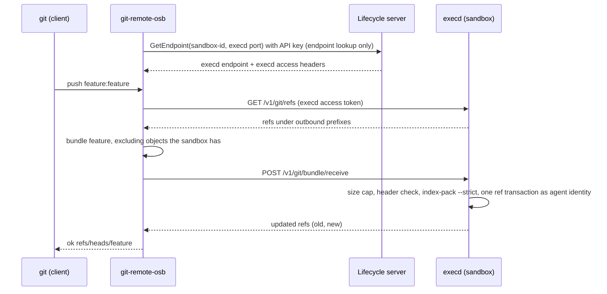
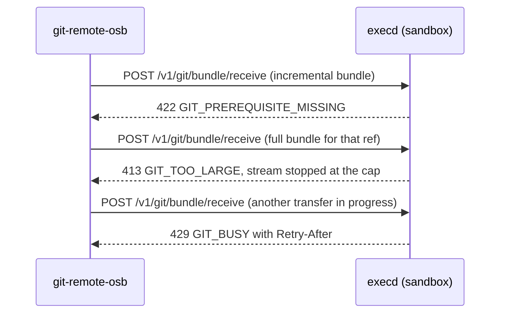

# OSEP-0027: Sandbox Git Transport

<!-- toc -->
- [Summary](#summary)
- [Motivation](#motivation)
  - [Current State](#current-state)
  - [Goals](#goals)
  - [Non-Goals](#non-goals)
- [Requirements](#requirements)
- [Proposal](#proposal)
  - [Notes/Constraints/Caveats](#notesconstraintscaveats)
  - [Risks and Mitigations](#risks-and-mitigations)
- [Design Details](#design-details)
  - [Configuration](#configuration)
  - [execd API](#execd-api)
  - [Repository Resolution](#repository-resolution)
  - [Ref Rules](#ref-rules)
  - [Running git](#running-git)
  - [Staging and Size Caps](#staging-and-size-caps)
  - [Concurrency and Failure Semantics](#concurrency-and-failure-semantics)
  - [Bundle Semantics](#bundle-semantics)
  - [Client Helper](#client-helper)
  - [SDK Impact](#sdk-impact)
  - [Docker and Kubernetes](#docker-and-kubernetes)
  - [Observability](#observability)
  - [Relationship to Prior OSEPs](#relationship-to-prior-oseps)
  - [Measurements](#measurements)
  - [Open Questions and Recommendations](#open-questions-and-recommendations)
- [Test Plan](#test-plan)
- [Drawbacks](#drawbacks)
- [Alternatives](#alternatives)
- [Infrastructure Needed](#infrastructure-needed)
- [Upgrade & Migration Strategy](#upgrade--migration-strategy)
<!-- /toc -->

## Summary

Coding agents need a repository inside the sandbox and need their commits to come back out. This proposal adds opt-in execd endpoints that list refs, receive a git bundle into a ref, and create a bundle for named refs, plus a `git-remote-osb` helper so that `git push` and `git fetch` work against a sandbox. The sandbox holds no source-control credential and needs no network route to a git host, because commits cross the client-to-execd channel that already exists.

## Motivation

Moving a repository through a sandbox today means one of three things: a source-control token inside the sandbox, an egress route to the git host, or copying files without history. Each leaves a credential, a route, or the commit history behind. Coding agents are a named workload in the [project charter](../CHARTER.md), and getting their commits out for review is the central step of that workload.

The client already has an authenticated channel to execd, and it already holds whatever credentials the git host needs. Carrying git objects over that channel removes the token and the route from the sandbox, and leaves the decision to publish with the client.

### Current State

- execd serves one HTTP API behind an access-token middleware that covers every route except liveness, readiness, and `/internal/init` (`components/execd/pkg/web/router.go`). Its routes cover files, directories, commands, code contexts, PTY, metrics, and isolated sessions. There is no git route (`components/execd/pkg/web/router.go`, `specs/execd-api.yaml`).
- Files move through `/files/upload` and `/files/download` (`components/execd/pkg/web/controller/filesystem_upload.go`, `filesystem_download.go`). They carry file bytes only, so history, branches, and authorship are lost. Agent-planted symlinks escaping bind mounts through the API are tracked in [issue #2332](https://github.com/opensandbox-group/OpenSandbox/issues/2332), with a fix for session file views in open [PR #2391](https://github.com/opensandbox-group/OpenSandbox/pull/2391). Two open reports show where the upload and download handlers are weak and shape this design: [#2444](https://github.com/opensandbox-group/OpenSandbox/issues/2444) (the upload handler writes the file before validating its metadata) and [#2450](https://github.com/opensandbox-group/OpenSandbox/issues/2450) (the download handler does not reject directories and returns an error without a message).
- Isolated sessions expose `diff` and `commit` over overlay filesystem changes (`specs/execd-api.yaml`, `/v1/isolated/session/{sessionId}/diff` and `/commit`). They do not produce git history.
- Clients reach execd through the endpoint and headers returned by the lifecycle server's `GetEndpoint` (`get_sandbox_endpoint` in `server/opensandbox_server/api/lifecycle.py`). The lifecycle API authenticates with the `OPEN-SANDBOX-API-KEY` header (`specs/sandbox-lifecycle.yml`). The server-proxy route is deprecated in favor of the ingress gateway (same file, `use_server_proxy`), so file, command, and PTY traffic goes directly from the client to the resolved execd endpoint and not through the lifecycle server.
- execd already runs user-selected identities for filesystem calls (`/v1/filesystem/{uid}/{gid}/...` in `components/execd/pkg/web/router.go`; `filesystemCredential` in `components/execd/pkg/runtime/filesystem_worker_linux.go`). When the operator enables hardening, user code is launched through a native launcher with reduced capabilities, `no_new_privs`, seccomp, and Landlock (`components/execd/pkg/isolation/config.go`, OSEP-0018).
- Operator-owned execd settings come from a TOML file named by `EXECD_ISOLATION_CONFIG` (`components/execd/pkg/isolation/config.go`, examples in `components/execd/configs/`). Sandbox envs delivered at runtime init reach user workloads and not `os.Getenv` of execd (`components/execd/pkg/runtime/env.go`, `bindingSandboxEnvs`).
- The `osb` CLI is a Python package that registers `opensandbox` and `osb` console scripts (`cli/pyproject.toml`) and reads the API key and domain from flags, `OPEN_SANDBOX_API_KEY` and `OPEN_SANDBOX_DOMAIN`, or its config file (`cli/src/opensandbox_cli/config.py`).
- Sandbox SDKs exist for Python, JavaScript/TypeScript, Kotlin, C#, and Go under `sdks/sandbox/`.

### Goals

1. Let a client push commits into a sandbox repository and fetch the agent's commits out of it with ordinary `git push` and `git fetch`.
2. Require no source-control credential and no egress route to any git host inside the sandbox.
3. Work with any git host, and with none, because the transport never contacts one.
4. Enforce ref allow-lists and size caps inside the sandbox, in execd, with configuration that an operator sets per deployment or per template.
5. Stay additive: off by default, no lifecycle API change, no change for existing sandboxes, the same behavior on Docker and Kubernetes.
6. Offer the same typed operations in the five sandbox SDKs.

### Non-Goals

1. Contacting a git host, opening pull requests, or holding or brokering source-control credentials.
2. Commit signing, trailer, or message policy, and ref naming conventions. Commits cross unchanged, and callers that need such rules apply them before sending or after receiving a bundle.
3. Being a general git server: no multi-user access control, hooks, or web UI.
4. Scanning commit content for secrets or policy violations. Clients can run their own pre-publish checks.
5. Git LFS, submodule recursion, shallow or partial bundles, and ref deletion in the first version.
6. Windows sandboxes.

## Requirements

| ID | Requirement | Priority |
|----|-------------|----------|
| R1 | The feature is off until the operator configures a repository root; with no root every git endpoint fails closed | Must Have |
| R2 | A repository path resolves under the configured root with no symlink in any component, and its `.git` has no redirect to another repository | Must Have |
| R3 | An inbound bundle may only create or update refs under the sandbox's inbound prefixes, and only refs under the outbound prefixes can be listed or bundled | Must Have |
| R4 | Bundle size is capped in both directions, rejected early when declared and enforced on the stream when not | Must Have |
| R5 | Every git process runs under the agent's uid and gid, and under the hardening floor when enabled, never with execd's credentials | Must Have |
| R6 | Repository configuration, hooks, and ambient git configuration cannot execute code or redirect git, as defense in depth on top of R5 | Must Have |
| R7 | An inbound bundle is rejected when it targets a branch checked out in any worktree, checked under the repository lock; Ref Rules describes the race that remains | Must Have |
| R8 | Transfers are serialized per repository and bounded globally, with a timeout, and a multi-ref update is atomic and can carry an expected-old check | Must Have |
| R9 | Every transfer is logged with operation, repository, refs, old and new object IDs, byte count, result, and the caller's `X-Request-ID` when one is sent | Must Have |
| R10 | `git push` and `git fetch` work through a helper shipped with the `osb` CLI | Must Have |
| R11 | The five sandbox SDKs expose the same operations | Must Have |
| R12 | A client can discover support before use, and an execd without the feature reads as unsupported | Must Have |
| R13 | Transfers after the first are incremental | Should Have |
| R14 | A first push into an empty sandbox creates the repository | Should Have |

## Proposal

execd gains four endpoints under `/v1/git`, behind the existing access-token check: `capabilities`, `refs`, `bundle/create`, and `bundle/receive`. Clients reach them the way the SDKs already reach execd for commands and files: resolve the sandbox endpoint with `GetEndpoint`, then call execd directly with the execd access token. The lifecycle server carries no git traffic, so its API and data path do not change.

The `osb` CLI package registers a `git-remote-osb` executable. Git runs any executable named `git-remote-<scheme>` for a remote URL of the form `<scheme>://`, so after `git remote add sandbox osb://<sandbox-id>/workspace/repo`, plain `git fetch sandbox` and `git push sandbox feature:feature` work. The helper speaks git's remote-helper protocol (`capabilities`, `list`, `fetch`, `push`) on one side and the execd endpoints on the other, using the CLI's existing API key only to resolve the endpoint.

Figure 1 shows a push from the client into a sandbox.



*Figure 1. Push from client into sandbox (container view).* Nothing in this flow gives the sandbox a credential or a route to a git host. The client publishes with its own credentials, outside the sandbox, if and when it chooses to.

Figure 2 shows the failure paths that matter for an implementer.



*Figure 2. Retry, cap, and contention responses.* Only `GIT_PREREQUISITE_MISSING` triggers the full-bundle retry. The other two are surfaced to the caller.

### Notes/Constraints/Caveats

- The sandbox image must contain `git` 2.34 or newer. That is the oldest version the prototype tested, and git 2.25 cannot run the design because its `update-ref --stdin` has no transaction commands and its `git init` has no `--initial-branch` or `--object-format`. `GET /v1/git/capabilities` reports `enabled: false` with a reason when git is missing or older than the minimum, and reports `git_version` otherwise.
- The transport adds no read capability for an authenticated caller, who can already download any file execd can read through `/files/download`. It changes where credentials and routes live, and gives one place to enforce ref and size policy.
- The allow-lists are a guardrail for the caller and the helper, not a confidentiality boundary against the party that holds the execd access token.
- Bundles carry git objects only. File modes, ownership, and untracked files are not transferred. After a branch lands, the caller materializes the working tree through the command API, for example `git reset --hard`.
- A bundle produced by the agent is untrusted input to the client, which imports it as objects and namespaced refs and runs nothing from it.
- execd's policy is a floor. A caller that serves several users, or that needs stricter rules than the sandbox's prefixes, checks mappings and bundle contents itself before sending or after receiving.
- The transport is an execd route and is guarded by the same access token as the other routes. Per-user authorization and audit belong to the caller (see [Observability](#observability)).
- Pause, restart, and renewal behavior during a transfer is described under [Concurrency and Failure Semantics](#concurrency-and-failure-semantics).

### Risks and Mitigations

| Risk | Impact | Mitigation |
|------|--------|-----------|
| The agent controls the repository, so `.git/config` or `.git` contents can name commands that run when execd runs git | Code execution with execd's privilege | R5: git runs under the agent's uid and gid after an ownership check, and under the hardening floor when enabled. R6 closes known vectors on top of that. With hardening off and a root agent, R6 is the only remaining boundary, so the guide tells operators to enable hardening first |
| The agent swaps a path component while root-privileged execd operates on it by name | Privilege escalation or access outside the repository | Resolution, `init`, and staging use descriptors; git gets the repository as an inherited descriptor and the bundle on stdin and stdout; execd never chowns a path by name |
| A crafted bundle or concurrent transfers exhaust sandbox disk, memory, or CPU | Sandbox or execd unavailable | Stream cap at cap+1, per-repository lock, global concurrency limit, timeout that kills the process group |
| A malicious sandbox returns a bundle that overwrites or shadows client refs, or carries malformed objects | Client repository corruption or misleading review | Branches and tags land in private namespaces under `refs/remotes/<remote>/` and `refs/osb/<remote>/`; the helper imports with the strict rule in [Bundle Semantics](#bundle-semantics); nothing is checked out |
| An inbound push overwrites the branch the agent is working on | Lost agent work | Rejected for a branch checked out in any worktree; see [Ref Rules](#ref-rules) for the race that remains |
| A multi-ref update applies partially, or a replayed force update rewinds new agent commits | Inconsistent refs, lost work | One ref transaction; expected-old check on forced refs |
| Committed secrets leave the sandbox in a bundle | Credential exposure to the client | Out of scope (Non-Goal 4); every transfer is logged |

## Design Details

### Configuration

A new `[git]` table in the operator-owned TOML file named by `EXECD_ISOLATION_CONFIG`. The server does not provision this file per sandbox today, so policy is per deployment, or per template where an operator builds one, in the same way hardening and Landlock settings are provisioned. Docker operators supply the file the way they supply it for those settings.

| Key | Default | Meaning |
|-----|---------|---------|
| `repo_root` | unset | Directory under which repositories may be used. Unset disables the feature |
| `run_as` | unset | `uid:gid` that git runs as. When unset, the owner of the repository directory, subject to the ownership check in [Running git](#running-git) |
| `inbound_prefixes` | `["refs/heads/"]` | Ref prefixes an inbound bundle may create or update |
| `outbound_prefixes` | `["refs/heads/", "refs/tags/"]` | Ref prefixes that can be listed and bundled |
| `max_bundle_bytes` | `268435456` | Maximum bundle size in either direction |
| `max_concurrent_transfers` | `2` | Concurrent transfers across all repositories |
| `timeout_seconds` | `300` | Limit for a whole transfer, including the upload and the time execd spends processing it |

Prefixes are matched literally against the full ref name; there is no glob syntax. A request can name explicit refs, and a listing can pass `prefix` to narrow, and neither can reach outside the configured prefixes.

### execd API

Paths are relative to the execd endpoint. Handler errors use the existing `{code, message}` body and always carry both fields, which `specs/execd-api.yaml` requires and #2450 shows is easy to miss. Messages are generic. A repository path, a staging path, or git's raw stderr never appears in a response body, and the detail goes to the log with the request ID. The access-token middleware's own 401 and pre-init 503 keep their existing `{error}` body, and the SDKs map both shapes.

| Endpoint | Request | Success |
|----------|---------|---------|
| `GET /v1/git/capabilities` | none | `{enabled, version, repo_root, object_format, git_version, max_bundle_bytes, inbound_prefixes, outbound_prefixes}`; `{enabled: false, reason}` when off, git is missing, or `/proc` is not available |
| `GET /v1/git/refs` | query `path`, optional repeated `prefix` | `{head?, refs: [{name, sha}]}`; `head` is omitted when the ref it names is outside the outbound prefixes |
| `POST /v1/git/bundle/create` | JSON `{path, refs[], haves[]}` | 200 `application/x-git-bundle` with `Content-Length`; 204 when nothing new |
| `POST /v1/git/bundle/receive` | query `path`, repeated `ref=[+]<src>:<dst>[@<old-sha>]`, optional `init=true`; body is the bundle, or empty when every `<src>` is an object ID | `{updated: [{ref, old?, new}]}` |

A mapping with `@<old-sha>` applies only if `<dst>` currently points at that object, like `--force-with-lease`. The lease is the suffix after the last `@` when it is exactly 40 lowercase hex characters, and otherwise the whole value is `<dst>`. Ref names are limited to 200 bytes, so 64 mappings of the longest form (`+<src>:<dst>@<old-sha>`) stay under the 32 KiB query limit. A mapping with `+` and no `@` is an unconditional force. The helper and SDKs always send `@<old-sha>` with `+`.

`object_format` is `sha1` in this version. Repositories using another object format are rejected, and `init=true` creates a `sha1` repository.

| Status | Code | Meaning |
|--------|------|---------|
| 400 | `INVALID_REQUEST_BODY` | Bad ref name, one over 200 bytes, bad object ID, mapping, or JSON; over 64 refs on receive, 256 on create, or 4096 haves |
| 403 | `GIT_REF_DENIED` | Ref outside the configured prefixes |
| 403 | `GIT_PATH_DENIED` | Path outside the root, a symlink or redirect in it, a linked worktree, or a failed ownership, mode, or `include` check on `.git` |
| 404 | `GIT_REPO_NOT_FOUND` | No repository at the path |
| 408 | `GIT_UPLOAD_STALLED` | The upload rate stayed under the minimum for the whole window |
| 409 | `GIT_REF_CHECKED_OUT` | Destination is checked out in any worktree |
| 409 | `GIT_NOT_FAST_FORWARD` | Update is not a fast-forward and the mapping has no `+` |
| 409 | `GIT_STALE_LEASE` | `<dst>` no longer points at `<old-sha>` |
| 409 | `GIT_REF_LOCKED` | A ref lock is held, by the agent or left by an interrupted git; execd never deletes lock files |
| 409 | `GIT_INIT_TARGET_NOT_EMPTY` | `init=true` target exists and is not an empty directory |
| 413 | `GIT_TOO_LARGE` | Over `max_bundle_bytes` |
| 414 | `INVALID_REQUEST` | Query longer than 32 KiB |
| 422 | `GIT_PREREQUISITE_MISSING` | The sandbox lacks commits the bundle needs, or an object ID named as a source |
| 422 | `GIT_BUNDLE_INVALID` | Bundle fails verification or lacks the named source ref |
| 429 | `GIT_BUSY` | Another transfer holds the repository or the global limit is reached; `Retry-After` is set |
| 501 | `NOT_SUPPORTED` | Feature disabled, or execd cannot switch to the repository's identity |
| 504 | `GIT_TIMEOUT` | The transfer exceeded `timeout_seconds`; git was killed and no ref changed |

Clients decide on the `code` in the body, never on the status alone, because the ingress path has its own 404s and 503s for sandboxes that are missing, expired, or paused. A 404 without `GIT_REPO_NOT_FOUND` means the sandbox or route is unavailable. On `capabilities`, a 404 is read as "unsupported" only if `GET /ping`, which every execd serves, answers 200. Otherwise the sandbox is reported as unavailable.

Fields are additive and clients ignore fields they do not know. `version` increases only for an incompatible change, and a client refuses a `version` greater than it knows.

### Repository Resolution

The transport resolves repository paths with Go's `os.Root`, which refuses any path that escapes the root and is the same primitive that PR #2391 uses for session file views (#2332). Once the shared code exists, the transport uses it. If the transport is implemented first, it carries the few lines it needs, and the two converge on one helper during review.

`os.Root` allows symlinks that stay inside the root, and this feature allows none. execd therefore opens `repo_root` as a root, walks `path` one component at a time with `Lstat`, and rejects any symlink. It opens the repository directory as a root of its own and keeps an open descriptor on `.git`. Ownership and type checks use that descriptor and `Lstat` calls inside the repository root, not a second lookup by name.

git receives the repository directory as an inherited descriptor (`--git-dir=/proc/self/fd/<n>`, where `<n>` is the descriptor number execd passes). The descriptor pins the directory, and a descriptor opened by execd stays usable after git drops to the repository owner. Entries below it are resolved by git under the agent identity, so a swap after execd's checks gives the agent nothing beyond its own access, and the checks on `.git` entries keep honest repositories self-contained and are not the security boundary. This resolution is Linux-only because of `/proc`, and the feature reports `enabled: false` with a reason elsewhere.

execd rejects a repository whose top-level `.git` contains a symlink at `objects`, `refs`, or `HEAD`, or contains `commondir`, `objects/info/alternates`, or `info/grafts`. These are the ways to make git read another repository.

`path` must be the main working tree. A linked worktree has a `.git` file and not a `.git` directory, so it is rejected with `GIT_PATH_DENIED`. Refs created from a linked worktree are visible through the main working tree.

execd validates every request parameter, ref name, and object ID before it creates a staging file, reads the body, or touches the repository, so a rejected request leaves nothing behind. This is the ordering that #2444 shows the upload handler lacks.

For `init=true`, the target must be absent or an empty directory under the root and not the root itself, and its parent must pass the same walk. execd creates it with `Root.Mkdir`, assigns it with `Root.Lchown` to `run_as` or to the owner of `repo_root`, and runs `git init --initial-branch=<first destination branch> --object-format=sha1` against a descriptor on the new directory.

### Ref Rules

A ref named by a caller must start with `refs/` and pass `git check-ref-format`. The `refs/` requirement also means no caller value can be parsed by git as an option. One denied ref fails the whole request before any change.

- Updates are fast-forward only unless the mapping carries `+`.
- Tags are listable and bundleable by default and are not writable by default.
- Ref deletion is not supported.
- A write whose destination is checked out in any worktree of the repository returns `GIT_REF_CHECKED_OUT`. execd reads `HEAD` of the main tree and of each linked worktree under the repository lock. Because the update is a ref transaction and not a `git fetch`, git's own checked-out check does not apply, and an agent that runs `git checkout` between the check and the update can end up with a branch that moved under its worktree. That leaves a dirty worktree and no corruption.
- Because `init=true` creates `HEAD` on the first destination branch, that branch is unborn and writable once. The next push to it returns `GIT_REF_CHECKED_OUT`, and the caller checks the tree out with `git reset --hard` through the command API.

### Running git

R5 is the enforced boundary. execd runs every git process under the agent's uid and gid, which is `run_as` when set and otherwise the owner of the repository directory, with supplementary groups from the account as `filesystemCredential` builds them (`components/execd/pkg/runtime/filesystem_worker_linux.go`). There is no fallback to execd's credentials. If execd cannot switch to that identity and its own uid differs from it, the feature reports `enabled: false`.

Before any git call, execd checks what git will read:

- Every entry directly under `.git`, other than the contents of `objects` and `refs`, has the target uid and no group or other write bit. This covers `config`, `hooks`, `config.worktree` and `info`.
- `.git/config` contains no `include` or `includeIf` section.
- A derived identity of uid 0 is refused unless `run_as = "0:0"` is set explicitly.

A failed check returns `GIT_PATH_DENIED` with the entry named. One consequence is that a root process which writes into the agent's `.git`, for example an operator running `git` as root inside the sandbox, makes the repository refuse transfers until ownership is restored. The checks keep git from reading files the agent identity could not have written.

When the operator has enabled the hardening floor, git is launched through the native launcher and runs under it, including the existing Landlock allowlist, with `repo_root` added as writable when it is outside the default writable set. Hardening and Landlock default to off. Deployments where the agent runs as root should enable hardening first, because with hardening off and a root agent, git runs as root and R6 is the only remaining boundary.

The `git` binary is an absolute path resolved at startup. execd checks the binary's path before it first executes it, runs its own `--version` and `--exec-path` probes with a scrubbed environment so that execd's access token never reaches the binary, refuses a git older than 2.34, and disables the feature when that binary, the `--exec-path` directory, or any parent of either is writable by a non-root user.

R6 adds fixed overrides and a rebuilt environment on every call. They are defense in depth for the commands execd runs: `for-each-ref`, `symbolic-ref`, `rev-parse`, `merge-base`, `worktree list`, `cat-file`, `bundle create`, `index-pack`, `update-ref`, and `init`.

| Setting | Closes |
|---------|--------|
| `core.hooksPath=/dev/null` | Hooks such as `reference-transaction`, which runs on ref updates |
| `core.fsmonitor=false` | An fsmonitor command run on index operations |
| `core.alternateRefsCommand=` | A command git runs to list refs of alternate object stores |
| `gc.auto=0`, `maintenance.auto=false` | Background gc or maintenance started after an update |
| `protocol.allow=never` | Any remote transport. execd never fetches or pushes |
| `pack.threads=1`, `pack.windowMemory=256m` | Memory growth while packing or indexing, which can push the sandbox's cgroup into an OOM kill that also takes down execd |
| `core.bigFileThreshold=4m` on `bundle create` | The delta search over large objects, which dominates the silent time before the first byte on large incompressible data. Small objects are still deltified |
| `GIT_CONFIG_NOSYSTEM=1`, `GIT_CONFIG_GLOBAL=/dev/null`, `HOME=/nonexistent`, `GIT_TERMINAL_PROMPT=0`, `GIT_NO_REPLACE_OBJECTS=1` | Ambient configuration, prompts, replace refs |

The environment is rebuilt from a fixed `PATH`, so variables such as `GIT_SSH_COMMAND` and `GIT_EXEC_PATH` do not reach git.

### Staging and Size Caps

Staging uses unlinked files. Each request creates one with `O_CREAT|O_EXCL|O_NOFOLLOW` in a private directory outside `repo_root` and unlinks it at once, so it exists only as an open descriptor. The directory matters only for the instant before the unlink. execd never changes the owner of a staging file and never opens one by name.

git sees the bytes only as its stdin or stdout. A path such as `/proc/self/fd/N` would not work, because a git process that has dropped to the repository owner cannot reopen a root-owned file through it.

Inbound: execd writes the request body to the staging descriptor through a writer that stops at the cap, and later gives it to git on stdin. A declared `Content-Length` over the cap is rejected before the body is read, and a chunked or understated body is stopped at the cap.

Outbound: execd runs `git bundle create -` and copies git's stdout through the same capped writer into a staging descriptor. At cap+1 bytes it kills git and returns `GIT_TOO_LARGE`. Only after git exits successfully does execd send the content, which gives clients a status code and a `Content-Length` and not a truncated stream.

Staging disk is bounded by `max_bundle_bytes` times `max_concurrent_transfers`. An accepted bundle also grows the repository by up to its own size, because git indexes the pack into the repository. Descriptors close on every exit path, and an execd crash leaves nothing behind because the files are unlinked at creation. The helper enforces the same cap on its side.

### Concurrency and Failure Semantics

execd takes a lock per repository, keyed on device and inode, and a slot from a global semaphore of `max_concurrent_transfers`. For `init=true`, where the target has no inode yet, the key is the parent's device and inode plus the final path component, held until the first ref transaction commits. Both are taken before the request body is read, so a request that cannot take either gets `GIT_BUSY` with `Retry-After` and is answered before the body is read. execd sets `Connection: close` on its 408, 413, and 429 responses, because the Go server otherwise drains an unread request body of up to 256 KiB before it sends the response, and a client that trickles the body can hold the connection. Clients should send `Expect: 100-continue` on `bundle/receive` where their HTTP client supports it, so they do not upload a large body into a response that is already decided.

The timeout covers the upload as well as processing. A stalled upload is ended with `GIT_UPLOAD_STALLED` when its rate stays under 64 KiB/s averaged over 30 seconds. On expiry execd kills git's process group, closes staging, and answers `GIT_TIMEOUT`.

Ref updates are applied in one `git update-ref --stdin` transaction after execd has imported the objects and checked fast-forward status and every `@<old-sha>`. Every `update` line carries the old object ID execd observed, or the zero ID for a create, so git rejects the whole transaction if any ref moved in between, including by the agent's own git, which does not take execd's lock. A mismatch returns `GIT_STALE_LEASE` for a leased mapping and `GIT_NOT_FAST_FORWARD` otherwise. A rejected ref leaves every ref unchanged, and the response is the error and not a partial `updated` list.

Retrying a failed or cut-off receive is safe for fast-forward mappings and for mappings with `@<old-sha>`. Replaying a completed fast-forward reports `old` equal to `new`, and replaying a leased update returns `GIT_STALE_LEASE`. An unconditional `+` is not safe to replay once the agent has committed on the destination, which is why the helper and SDKs never send one without a lease.

The agent's own git processes, and a git killed by a timeout or frozen by a pause, can leave `*.lock` files. execd reports `GIT_REF_LOCKED` and does not delete locks, so the caller or the agent decides how to clear them. A repository larger than `max_bundle_bytes` cannot be sent in one bundle, and the caller can seed it in steps by pushing older refs or tags first, since each later bundle excludes what the sandbox already has.

The transport is synchronous. A `bundle/create` response starts only after the bundle is built, and a `bundle/receive` response starts only after verification and the ref update, so a proxy with a short idle timeout can cut either request on a large repository. `timeout_seconds` and `max_bundle_bytes` must be set so the slowest silent phase finishes inside the idle timeout of the path in use. [Measurements](#measurements) show the silent phases at the default cap are well inside 60 seconds.

Access through the ingress gateway renews a sandbox only when it opted into renewal under [OSEP-0009](0009-auto-renew-sandbox-on-ingress-access.md), and never in Docker direct mode. The transport adds no special handling. If a sandbox is paused or restarted during a transfer, the ingress path answers with its own 503 and `Retry-After` ([OSEP-0024](0024-auto-pause-and-wake-on-access-for-fast-sandbox.md)) and the client retries under the retry rules in this section.

### Bundle Semantics

- Outbound: `haves` are object IDs the client believes the sandbox has. execd drops IDs it does not have, because git refuses unknown revisions, and excludes the rest. When nothing new remains, git refuses to create an empty bundle and execd returns 204.
- Inbound: the helper lists sandbox refs and excludes from the bundle the tips it also has locally. If a prerequisite is missing, execd returns `GIT_PREREQUISITE_MISSING` and the helper retries once with a full bundle for that ref, within the cap.
- Each inbound ref is mapped explicitly as `[+]<src>:<dst>[@<old-sha>]`. A `src` that is not in the bundle, or that is not a commit after import, returns `GIT_BUNDLE_INVALID`.
- Pointing a ref at an object the sandbox already has needs no bundle, and git refuses to create an empty one. In that case the body is empty and each `<src>` is a full object ID. execd requires every one to be a commit already in the repository, and answers `GIT_PREREQUISITE_MISSING` otherwise. The prefix, checked-out, fast-forward, and lease rules apply as for any other mapping.
- Unsupported repository features have defined behavior. The helper refuses a client repository that is shallow or a partial clone, with a message that names the cause. It warns when `.gitattributes` on a pushed tip uses `filter=lfs`, because the LFS objects do not travel. Submodules cross as gitlinks only, and each submodule is transferred as its own repository path.

The import rule is the same on both sides, because git's own bundle commands do not check objects reliably. `git bundle unbundle` accepts a malformed commit even with `transfer.fsckObjects` set, and `git fetch` from a bundle accepted it on git 2.34 and 2.39 and rejected it on 2.47 in the prototype. The importer therefore reads the bundle header and feeds the pack that follows it to `git index-pack --stdin --fix-thin --strict`, which rejected the same commit on all three versions.

The header rules are: only the `# v2 git bundle` and `# v3 git bundle` signatures, no capability other than `object-format=sha1`, at most 1 MiB and 4096 lines, and ref names that pass `git check-ref-format`. A `HEAD` line is allowed and ignored. Objects that arrive and are not referenced by an update stay unreferenced, and automatic gc is off.

### Client Helper

One helper ships with the `osb` CLI: `git-remote-osb`, registered as a console script in `cli/pyproject.toml`. A git remote helper is a process on `PATH`, not a library, so five copies would drift. It is built on the Python SDK operations in [SDK Impact](#sdk-impact), so there is one implementation of the protocol, and the CLI's minimum SDK version rises to the release that contains them.

It reads `osb://<sandbox-id>/<repo path>`, resolves the execd endpoint and headers with the CLI's connection settings and `GetEndpoint`, and implements `capabilities`, `list`, `fetch`, and `push`. It always resolves a direct endpoint and ignores the deprecated `use_server_proxy` setting, so a bundle never travels through the lifecycle server.

- Remote branches map to `refs/remotes/<remote>/*`. The helper lists the sandbox's tags as `refs/osb/tags/<name>` and never under `refs/tags/`. On first use it adds `+refs/osb/tags/*:refs/osb/<remote>/tags/*` to `remote.<name>.fetch` and sets `remote.<name>.tagOpt` to `--no-tags`, so git does not write `refs/tags/` from the sandbox's tags, a sandbox cannot shadow a client branch name, and a sandbox branch named `tags/x` does not collide with a tag.
- A push to a path with no repository gets `GIT_REPO_NOT_FOUND` on the `list for-push` that git sends first. The helper treats that as an empty sandbox and sends `init=true` with the push. The same error on a fetch is fatal.
- When a pushed ref's tip is already in the sandbox, `git bundle create` refuses an empty bundle, so the helper sends the object ID as `<src>` with an empty body.
- `haves` on fetch are the tips of `refs/remotes/<remote>/*`, which are known to exist in the sandbox, plus the merge bases of the refs being fetched. Other local branch tips are not sent, so a client repository shared by several users does not disclose unrelated commit IDs to a sandbox. At the 4096 limit, the tips of the most recently updated remote-tracking refs are kept first.
- The helper imports a downloaded bundle with the rule in [Bundle Semantics](#bundle-semantics) before updating any ref, so its safety does not depend on the client's git version.
- A forced push is sent as `+<src>:<dst>@<old-sha>`, with the old value taken from the remote helper `option cas` when git supplies it and otherwise from the `list` made at the start of the push.
- The helper generates an `X-Request-ID` for every transfer and includes it in every error it prints.
- Ref deletion is reported as an error for that ref.
- Query strings are percent-encoded, in particular `+` as `%2B`, since a bare `+` decodes to a space.

### SDK Impact

The SDKs add the same four operations on the sandbox handle, generated or adapted from `specs/execd-api.yaml`. Handwritten adapters stay separate from generated code, as `sdks/AGENTS.md` requires. Each SDK raises typed errors carrying the `code` from the error table in [execd API](#execd-api), placed under the existing API exception in the hierarchy of [OSEP-0017](0017-resilient-sdk-transport.md).

| SDK | Path | Change |
|-----|------|--------|
| Python | `sdks/sandbox/python` | `sandbox.git.capabilities`, `list_refs`, `create_bundle`, `receive_bundle`; regenerate the API client |
| JavaScript/TypeScript | `sdks/sandbox/javascript` | Same operations; regenerate the API client |
| Go | `sdks/sandbox/go` | Same operations on the existing execd client (`execd.go`) |
| Kotlin | `sdks/sandbox/kotlin` | Same operations; regenerate the API client |
| C# | `sdks/sandbox/csharp` | Same operations |

The operations move bytes and do not need a `git` binary. They take and return streams or file paths, not only in-memory buffers, so a 256 MiB bundle does not have to fit in memory and a relay can pass a bundle between two endpoints without parsing it. Each call sends an `X-Request-ID` and returns it in errors. Code-interpreter and MCP packages are unchanged. A Rust SDK is under review in PR #2492, and it would add the same operations if it merges.

Under OSEP-0017, `POST` requests are retried only when the SDK can prove nothing was sent. The git operations add one opt-in: a `429 GIT_BUSY` is retried with `Retry-After`, because the server rejects it before doing any work. That applies to `capabilities`, `refs`, `bundle/create`, and to `receive_bundle` from a file. A streamed `receive_bundle` surfaces the 429 to the caller, since the stream cannot be replayed. SDKs send `Expect: 100-continue` on `receive_bundle` where the HTTP client supports it.

For callers that do not use the helper, a fetch and a push with the retry look like this in Python:

```python
tips = remote_tracking_tips("sandbox") + merge_bases(wanted)
bundle = await sandbox.git.create_bundle(REPO, refs=["refs/heads/agent/fix"], haves=tips)
if bundle is not None:                      # None means 204: nothing new
    import_bundle(bundle, into="refs/remotes/sandbox/")

maps = [RefMapping("refs/heads/feature", "refs/heads/feature")]
try:
    await sandbox.git.receive_bundle(REPO, incremental, refs=maps)
except GitPrerequisiteMissing:
    await sandbox.git.receive_bundle(REPO, full, refs=maps)
```

A force update is `RefMapping(src, dst, force=True, expected_old=sha)`.

### Docker and Kubernetes

The API and behavior are the same on both runtimes. They differ in how an operator provisions the pieces.

| Aspect | Docker | Kubernetes |
|--------|--------|------------|
| Policy delivery | `EXECD_ISOLATION_CONFIG` file supplied by the operator | `EXECD_ISOLATION_CONFIG` file from a ConfigMap or the pod template, as in `server/opensandbox_server/examples/e2e.batchsandbox-template.yaml` |
| Route to execd | Direct endpoint or ingress gateway | `GetEndpoint` through the ingress gateway |
| Staging and repository disk | Container writable layer or a mounted volume | Pod ephemeral storage, counted against its limit |
| `git` binary | Must be in the sandbox image | Must be in the sandbox image |

Fast Sandbox runtimes are not evaluated in this proposal, and neither are secure-container runtimes ([OSEP-0004](0004-secure-container-runtime.md)). The feature is Linux-only and reports `enabled: false` with a reason when `/proc` is not available.

### Observability

execd writes one structured log record per transfer with operation, repository path, refs, old and new object IDs, byte count, duration, result including the rejection code, and the `X-Request-ID` request header when present. It also emits counters and a size histogram through the OpenTelemetry instrumentation of [OSEP-0010](0010-opentelemetry-instrumentation.md).

execd has no notion of which user a request is for, and under [OSEP-0014](0014-multi-tenancy.md) one tenant credential reaches all of that tenant's sandboxes. Per-user authorization and audit therefore belong to the caller, which correlates its own records with these through the request ID.

### Relationship to Prior OSEPs

- [OSEP-0011](0011-secure-access-endpoint.md): the transport uses the endpoint and access headers it defines.
- [OSEP-0012](0012-credential-vault.md) and [OSEP-0001](0001-fqdn-based-egress-control.md): complementary; see Alternatives.
- [OSEP-0013](0013-isolated-execution-api.md): no overlap; see Alternatives.
- [OSEP-0018](0018-execd-as-sandbox-init.md): git runs under its hardening floor when enabled.
- [OSEP-0010](0010-opentelemetry-instrumentation.md): provides the metric pipeline.
- [OSEP-0009](0009-auto-renew-sandbox-on-ingress-access.md), [OSEP-0017](0017-resilient-sdk-transport.md), [OSEP-0024](0024-auto-pause-and-wake-on-access-for-fast-sandbox.md), [OSEP-0014](0014-multi-tenancy.md): renewal, retry, wake and tenancy behavior described in the sections above.
- Issue #2332 and PR #2391: the path-safety work this proposal builds on, see [Repository Resolution](#repository-resolution).
- DeepSeek Harness plugin ([PR #2163](https://github.com/opensandbox-group/OpenSandbox/pull/2163)): a coding-harness integration whose diff shows no repository transfer. It could use the JavaScript SDK operations to seed a working directory. No existing issue or OSEP covers repository transfer.

### Measurements

A prototype of this design ([prototype at commit `364e47c`](https://github.com/opensandbox-group/OpenSandbox/tree/364e47c403abc2198156a92c2971a063d9858f4b), not part of this proposal and not intended to merge) was run on Linux 6.8 in an arm64 virtual machine with 4 vCPUs and no CPU quota, with git 2.47.3 and Go 1.25. It ran the handlers in process with no network between client and execd, as root against repositories owned by uid 1000, with `pack.threads=1` and `core.bigFileThreshold=4m`. The tests are in `components/execd/pkg/web/controller/git_test.go` and run as root and as a non-root execd, the timing experiment is `git_perf_test.go` in the same directory, and `prototype/sandbox-git-transport/e2e.sh` runs execd and the helper with real `git push` and `git fetch` (19 checks). Between them they exercise the identity drop, the ownership checks, path swaps, leases and the update-ref race, init, timeouts and stalled uploads, tag shadowing by a hostile sandbox, and strict import of a malformed object.

Each row creates the full bundle of a repository and then receives it into a new repository with `init=true`. "Create" is the silent time before the first response byte. "Receive" is the silent time after the upload finishes. The random rows hold that many MiB of random data in 8 MiB files.

| Repository | Bundle | Create | Receive |
|------------|--------|--------|---------|
| Random binary, 40 MiB | 40.0 MiB | 0.9 s | 0.3 s |
| Random binary, 136 MiB | 136.0 MiB | 3.6 s | 1.2 s |
| Random binary, 264 MiB | 264.1 MiB | 5.8 s | 2.2 s |
| Random binary, 520 MiB | 520.2 MiB | 11.7 s | 3.1 s |
| This project's repository (118 MiB packed) | 114.8 MiB | 1.4 s | 2.5 s |

Receive was measured only into an empty repository, so these figures describe this machine and these repositories, not a bound.

Random data is the worst case for git's delta search, not for size. Without `core.bigFileThreshold=4m`, creating the 264 MiB row took 24.6 s, with the same bundle size. The setting does not cost size on the work agents actually produce. A bundle of 200 small agent commits on top of this project's history was 85,704 B with git's defaults and 79,337 B with the threshold. `pack.window=0`, which also fixes the time, made the same bundle 1,459,406 B and was rejected for that reason.

Two defaults of common proxies matter for these figures. nginx's `proxy_read_timeout` is 60 s between two successive reads ([nginx documentation](https://nginx.org/en/docs/http/ngx_http_proxy_module.html)). An AWS Application Load Balancer closes a connection after 60 s of inactivity by default, configurable from 1 to 4000 s, and AWS advises sending at least one byte before each idle period ([AWS documentation](https://docs.aws.amazon.com/elasticloadbalancing/latest/application/edit-load-balancer-attributes.html)).

With `Expect: 100-continue`, a request refused with 429 uploaded nothing in the prototype: curl sent 0 bytes of a 64 MiB body. Without it, curl sent 1.8 MB before it read the 429. The header saves the upload, and curl and httpx 0.28 (the Python SDK's HTTP client) both read the 429 body, with `Connection: close` set on the response.

The execd HTTP server sets no timeouts of its own (`components/execd/main.go`), and no timeout setting appears in the ingress gateway's request path, so any limit comes from what an operator puts in front.

### Open Questions and Recommendations

Each question has a recommendation that the maintainers can accept or change.

1. **Where does the git configuration live?** Recommendation: a `[git]` table in the existing execd TOML file. The file already holds the operator-owned hardening, Landlock, and eBPF tables, its path variable is already hidden from user workloads (`execdConfigEnvBlacklist`), and `LoadConfig` calls `toml.Unmarshal` without strict mode (`components/execd/pkg/isolation/config.go`), so an execd that does not know the table ignores it and answers 404 on `capabilities`. A second config file would add a path variable and a loader for no gain. Renaming the file or its variable is a separate cleanup.
2. **What is the default size cap?** Recommendation: keep 256 MiB. This project's own repository bundles to 115 MiB, so the default leaves more than 2x headroom for it. At the cap the measured silent phases are 5.8 s and 2.2 s, and staging disk is bounded at the cap times two concurrent transfers. Operators with larger repositories raise the cap and the proxy idle timeout together, or seed in steps ([Concurrency and Failure Semantics](#concurrency-and-failure-semantics)).
3. **Can the sandbox creator set ref prefixes per sandbox through the lifecycle API?** Recommendation: no, not in this proposal. The server has a place for per-sandbox settings (the `extensions` map in `server/opensandbox_server/extensions/`, for example `access.renew.extend.seconds`), but nothing there provisions execd configuration, so an API field would promise what the server cannot deliver. Operator or template policy is enough for v1, and a later additive extension key can reuse the same `[git]` keys.
4. **Does the helper ship in the `osb` package?** Recommendation: yes, as a console script in `cli/pyproject.toml`. `osb` already depends on the Python SDK that the helper is built on, and a second package would add a release and a version pin to keep in step. Keeping the helper in its own importable module leaves a later split possible.
5. **Does the transport wait for a shared #2332 resolver?** Recommendation: no. PR #2391 builds on `os.Root`, and the prototype's resolver uses the same primitive and passed `TestPathSwapRace`, `TestWorktreesAndInit`, and `TestOwnershipAndPaths` (symlinked `.git` entries, `commondir`, alternates, and grafts). The transport adopts the shared helper if it exists when the transport is implemented, and otherwise carries the few lines it needs.
6. **Is a synchronous API acceptable, or does it need start-then-poll?** Recommendation: synchronous in this version. On the test machine the silent phases at the default cap are at most 5.8 s and 2.2 s, against 60 s for the two common proxy defaults, and bytes flow during the upload and download themselves. The guide under `docs/guides/`, added in the rollout, tells operators who limit a sandbox to a small CPU quota to measure first and to raise the proxy idle timeout if needed. Start-then-poll becomes worth its extra state if measurements on such sandboxes exceed the idle timeouts.
7. **How should git get into the sandbox?** Recommendation: the operator installs it in the image, with the version floor and the capability reason above. Staging a pinned binary and replacing git with a library are both described under Alternatives, and either would remove the image requirement at a cost the maintainers are better placed to weigh, including the GPL-2.0 question for a staged binary.

## Test Plan

Handler tests in `components/execd` run real `git` and skip when it is absent:

- Disabled by default: `capabilities` reports `enabled: false`, and `refs`, `bundle/create`, and `bundle/receive` return 501 `NOT_SUPPORTED` without touching the path or reading the body. When enabled, `capabilities` reports `version` and `repo_root`. A 404 from an old execd reads as unsupported only when `/ping` answers, and otherwise as an unavailable sandbox.
- Round trip: inbound push, outbound incremental bundle, 204 when nothing new, unknown `haves` ignored.
- Ref rules: destination outside prefixes, checked-out branch, option-like and traversal ref names, missing source, malformed mapping, non-bundle body, and a server-side `GIT_NOT_FAST_FORWARD` driven through the SDK so client-side git cannot mask it.
- Atomicity: one rejected ref in a multi-ref receive leaves all refs unchanged. A forced mapping with a stale `@<old-sha>` returns `GIT_STALE_LEASE`, and a replayed lease-guarded update does not rewind new commits.
- Locks: a held or leftover ref lock returns `GIT_REF_LOCKED` and execd deletes nothing. A transfer cut by an execd restart or a pause can be retried.
- Size cap: declared oversize, chunked oversize, oversize outbound with git killed at cap+1, and a transfer just under the cap through the ingress gateway.
- Paths: symlinked repository, outside root, `..`, symlinked or redirecting `.git` entries (`commondir`, `alternates`, `grafts`), and a test that swaps a path component during a request.
- Staging: during an upload, no staging file is visible by name in the temp directory, root can read the staged bytes through the unlinked descriptor (the control), and a process running as the agent uid cannot.
- Import checking: a bundle whose commit has a malformed author line returns `GIT_BUNDLE_INVALID` and creates no ref, on the sandbox side and in the helper, and on git 2.34, 2.39, and the current release. A bundle with a `HEAD` line in its header is accepted, and a header over the size or line limit, an unknown capability, or a bad ref name is refused.
- Pointing a ref at an existing object with an empty body works, and an unknown object ID, a destination outside the prefixes, a ref source with no body, and a checked-out destination are refused.
- Timeouts: a git process that outlives `timeout_seconds` is killed with its process group and the response is `GIT_TIMEOUT`, and a trickled upload is cut with `GIT_UPLOAD_STALLED` near the end of the rate window.
- Binary safety: a git wrapper in a directory the agent can write makes `capabilities` report `enabled: false` and the other routes answer 501, and execd does not run it first. The probes run with a scrubbed environment, and a git below 2.34 is refused. The command set passes on git 2.34, 2.39, 2.43, and the current release.
- Hostile configuration: hooks, fsmonitor, gc, ssh command, and `core.alternateRefsCommand` in repository config do not execute. A negative-control run disables the overrides with a test-only switch and must see the marker file appear, which proves the fixture exercises the vector.
- Identity: with execd as root, git runs under the uid and gid of `run_as` or the repository owner, and under the hardening floor when enabled, never with execd's own credentials.
- `init=true`: the first push of `main` leaves `HEAD` on `main`, a second push to `main` returns `GIT_REF_CHECKED_OUT`, and `git reset --hard` through the command API produces the working tree. Also populated target, root as target, outside root, symlinked parent, and a race that swaps the parent during creation.
- Concurrency: second request gets `GIT_BUSY` with `Retry-After`, and a client that sent `Expect: 100-continue` sees that code and not a transport reset; two concurrent `init=true` requests for one new path serialize; an agent that moves a ref between execd's checks and the transaction makes the update fail with `GIT_STALE_LEASE` or `GIT_NOT_FAST_FORWARD`; global limit; a stalled upload is cut by the minimum-rate rule; timeout kills the process group and closes staging.
- Ownership: mixed ownership under `.git`, a root-owned or group-writable `.git/config`, an `include` section, and a derived uid of 0 without `run_as` return `GIT_PATH_DENIED`. If execd runs as a non-root uid that differs from the target, the feature reports `enabled: false`. The hostile-config cases also run with the hardening floor off.
- Resource limits: a bundle that would explode into loose objects or exhaust packing memory stays inside the configured bounds.
- Idle timeouts: a proxy with a short idle timeout in front of execd, with a transfer that exceeds it, fails with a transport error and leaves refs unchanged.
- Logging: each transfer record carries the R9 fields, including a supplied `X-Request-ID`.
- Error shape: every `/v1/git` handler error carries both `code` and `message`, and the SDKs also map the middleware's `{error}` body. A 404 without `GIT_REPO_NOT_FOUND` is reported as an unavailable sandbox.
- Linked worktree as `path` is rejected, and refs created in a linked worktree are listed through the main working tree.
- Validation order: a request with a bad ref or object ID leaves no staging file and does not read the body.
- Limits and messages: 64 mappings of 200-byte refs fit in the query limit, a 201-byte ref name is refused, a query over 32 KiB returns 414, and no error body contains a repository or staging path.

Helper and SDK tests:

- Remote-helper protocol conformance for `capabilities`, `list`, `fetch`, and `push` with real `git` against a fake execd, including incremental transfer, the `GIT_PREREQUISITE_MISSING` retry only on that code, and the client-side cap.
- A hostile fake execd cannot create refs outside `refs/remotes/<remote>/` and `refs/osb/<remote>/`, including a tag named like a client branch or a branch named `tags/x`, and a corrupt object fails the import.
- After local commits advance the client past the sandbox, a fetch excludes shared history.
- The helper refuses a shallow or partial client repository, warns on `filter=lfs`, ignores `use_server_proxy`, and sends only remote-tracking tips and merge bases as `haves`. A first push into an empty sandbox works, and a push of a ref the sandbox already has works with an empty body.
- One contract test per SDK against shared fixtures so the five agree on operations, error codes, request IDs, and the 429 retry rule.

End to end, in `tests/`: on the Docker runtime with `[git]` configured, push a repository, run a command that commits, fetch the commit, and confirm no git host resolves and no token exists in the sandbox. The Kubernetes e2e suite should run the same scenario.

## Drawbacks

- It adds a git dependency and a new attack surface to execd, which does not parse repository content today. Any future git feature or configuration key that executes code becomes a standing review item, and git has a history of vulnerabilities triggered by hostile repositories. The transport never checks out a tree or touches submodules, but the operator is still responsible for keeping the image's git patched.
- Every sandbox image that uses the feature must carry a recent enough git, and image maintainers and template authors take on that requirement. Minimal and distroless images do not have one.
- It adds a second way to reach a remote repository next to the Credential Vault, which some deployments will find sufficient.
- Bundles transfer less efficiently than the smart protocol, and the default cap will be too small for some repositories.
- The sandbox image needs `git`.
- Fast-forward-only inbound updates leave divergent branches for the client to reconcile.

## Alternatives

**Compose bundles on the client with the existing command and file APIs.** The client runs `git bundle create` through the command API, downloads the file, and uploads bundles to apply with `git fetch`. It needs no execd change and works for one trusted client today. It was not chosen because every SDK and client would carry its own copy of the hardening in [Running git](#running-git) and the path checks, and would build a shell command line from caller-supplied ref names. One hardened implementation in execd is easier to review and keep correct than five.

**Credential Vault plus an egress allow-list to the git host ([OSEP-0012](0012-credential-vault.md), [OSEP-0001](0001-fqdn-based-egress-control.md)).** This works today, keeps the token value out of the sandbox, and a method- and path-scoped binding limits where it applies. Fetching needs only a read binding. Returning commits needs a write-capable binding, which lets the agent publish without the client seeing the commits, and it needs a route to the host and a host that accepts HTTPS token authentication. It is the right choice for unattended publishing, and the two coexist.

**Use isolated-session `commit` ([OSEP-0013](0013-isolated-execution-api.md)).** It returns filesystem changes for an isolated session and carries no history, authorship, or branches.

**Implement bundle import and export inside execd without the git binary.** A Go library would remove the image requirement, the version floor, and the whole class of repository-configuration vectors in [Running git](#running-git). It was not chosen for the first version because it moves risk from git's mature parsers to a new parser running with execd's privilege on attacker-controlled bytes, it adds a large dependency to execd, and it would have to reproduce object checking, delta handling, and ref transactions that git already gets right. It is worth a spike if the maintainers weigh the image requirement more heavily than I have.

**Stage a pinned `git` with execd, as OSEP-0013 does for `bwrap`.** This fixes the version and the binary's integrity and needs no image change. It was not chosen because it adds a per-architecture build and a release artifact, and because git is licensed under GPL-2.0, so distributing it inside project artifacts adds source-offer obligations that the maintainers would need to accept. Operators who want it can already provide the same thing by installing git in their image.

**Run git through an isolated session ([OSEP-0013](0013-isolated-execution-api.md)).** The namespace gives git a read-only root and no network, which is more confinement than a uid drop. It was not chosen because it requires `bwrap`, which is not part of every deployment, and because the transfer needs write access to the repository and a pipe for the bundle bytes.

**Tunnel `upload-pack` and `receive-pack` first.** It sends only needed objects and scales to large repositories, and it remains future work for repositories too large to bundle. It was deferred because execd has no bidirectional streaming channel for it, and because enforcing ref prefixes inside `receive-pack` usually relies on hooks, which this design disables. Bundles need only request and response bodies.

**Have the sandbox push to a client-hosted remote.** It keeps credentials out of the sandbox and needs a route from the sandbox to the client, which sandboxes are built to avoid.

**Mount the workspace on the host through a volume ([OSEP-0003](0003-volume-and-volumebinding-support.md)) and run git there.** It avoids a new endpoint, but it runs git on the client side against a directory the agent controls, which is the hostile-configuration problem this design contains inside the sandbox, and it depends on runtime-specific volume support.

## Infrastructure Needed

- `git` in the sandbox images that use this feature, including the code-interpreter image in [opensandbox-group/sandbox-images](https://github.com/opensandbox-group/sandbox-images).
- `git` on the CI runners for execd and helper tests, and a Docker-runtime end-to-end job.
- No new services or third-party dependencies in the control plane.

## Upgrade & Migration Strategy

The change is additive. An execd without the feature is unchanged, and an execd with it does nothing until `[git] repo_root` is set. The lifecycle API, existing execd routes, and existing SDK methods are untouched, and API-key clients keep working.

Version skew is handled by discovery and by the `version` rule in [execd API](#execd-api). A client calling `/v1/git/capabilities` on an older execd gets a 404 from execd and reports that the sandbox does not support git transport. An older SDK never calls the new routes, and the `osb` package raises its minimum SDK version to the release that adds the operations.

To roll back or disable the feature, remove `repo_root` from the sandbox's configuration and restart or recreate the sandbox, since execd reads its configuration at startup.

The rollout order is: spec and execd endpoints with tests, then the Python SDK and the CLI helper, then the other four SDKs against shared fixtures, then a guide under `docs/guides/` and an update to `docs/architecture/data-plane/execd.md`.
